# Employee Management Full-Stack Application

The **Employee Management Full-Stack Application** is a modern, feature-rich system for managing employee and department data, built to demonstrate the power of combining traditional enterprise technologies with modern web frameworks. It leverages a responsive React frontend alongside a robust Spring Boot backend, delivering a seamless user experience with features such as CRUD operations, data visualization, authentication, and secure REST APIs. 

Designed with scalability and maintainability in mind, this application is also fully containerized with Docker, orchestrated with Kubernetes, and supports CI/CD pipelines & blue/green and canary deployment techniques through Jenkins, making it an ideal blueprint for real-world enterprise applications.

<p align="center">
  <a href="https://employee-manage-app.vercel.app" target="_blank">
    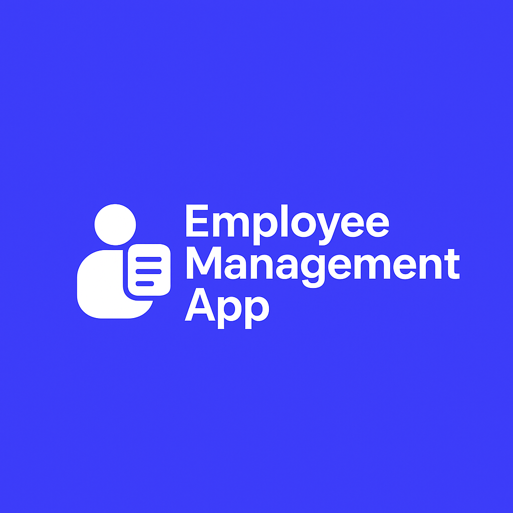
  </a>
</p>

## Overview

The Employee Management System is a dynamic full-stack application that seamlessly combines cutting-edge and traditional technologies. By integrating a modern **React** frontend with a classic **Spring Boot** backend, this project demonstrates how new and established technologies can harmoniously work together to create a robust and efficient application for managing employee and department data!

## Architecture at a Glance

- React SPA (Material UI, Tailwind CSS, Chart.js) consumes the Spring Boot REST API over HTTPS via Axios.
- Spring Boot layers (controller → service → repository) persist to MySQL through Spring Data JPA and seed demo data with Faker-powered `DataInitializer`.
- Production-ready deployment with Docker containers, Kubernetes orchestration (blue-green & canary strategies), Terraform infrastructure-as-code, and comprehensive Jenkins CI/CD pipeline with automated testing, security scanning, and multi-strategy deployments.

### System Context

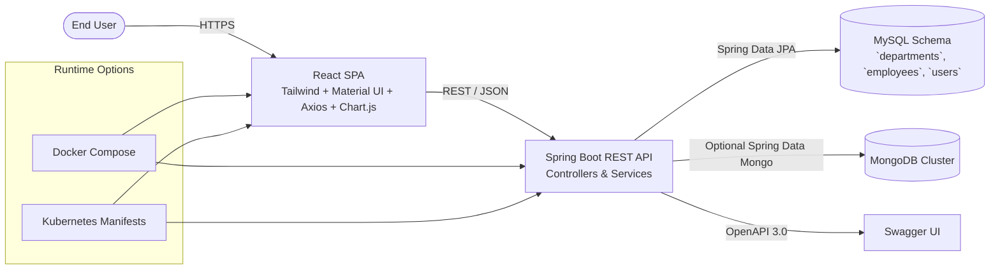

## Live Deployment

The Employee Management System full-stack app is deployed with Vercel and is live at [https://employee-manage-app.vercel.app](https://employee-manage-app.vercel.app) for you to explore and interact with the application.

The backend is also deployed with Render and is available at [https://employee-management-app.onrender.com](https://employee-management-app-gdm5.onrender.com/). You can access the API endpoints directly from the browser at the root (`/`) endpoint as we've set up the Swagger UI documentation for easy testing.

## Key Technologies

- **React (Frontend)**: A modern JavaScript library for building user interfaces, providing a responsive and interactive experience.
  - **React Router**: A routing library for React that enables navigation and URL handling in single-page applications.
  - **Chart.js**: A JavaScript library for creating responsive and customizable charts and graphs.
  - **React Three Fibers + Three.js + WebGL:** For 3D component stylings and appealing user experiences.
  - **Axios**: A promise-based HTTP client for making API requests.
  - **Tailwind CSS**: A utility-first CSS framework for creating custom designs with minimal CSS.
  - **Redux**: A predictable state container for managing application state.
  - **Jest and React Testing Library**: Testing libraries for unit and integration testing React components.
- **Java Spring Boot (Backend)**: A powerful, established Java framework for building production-ready applications with Java, offering robust backend support and data management.
  - **Spring Data JPA**: A part of the Spring Data project that makes it easy to implement JPA-based repositories.
  - **Spring Boot Actuator**: A set of production-ready features that help monitor and manage the application.
  - **Spring Hibernate**: An object-relational mapping (ORM) library for Java that provides a framework for mapping an object-oriented domain model to a relational database.
  - **Spring Boot Starter Web**: A starter for building web applications, including RESTful, application, and WebSocket services.
  - **Spring Boot Starter Data JPA**: A starter for using Spring Data JPA with Hibernate.
  - **RESTful APIs**: Representational state transfer (REST) APIs for communication between the frontend and backend.
  - **Java 11**: The latest LTS version of Java, providing long-term support and stability.
  - **JUnit 5**: A popular testing framework for Java that provides annotations for writing tests.
  - **Swagger**: A tool for documenting and testing RESTful APIs.
- **Docker**: A containerization platform for packaging applications and their dependencies.
- **Kubernetes**: An open-source container orchestration platform for automating deployment, scaling, and management of containerized applications.
- **Jenkins**: An open-source automation server that helps automate the parts of software development related to building, testing, and delivering, facilitating continuous integration and continuous delivery (CI/CD).
- **MySQL**: A reliable relational database for structured data storage.
- **MongoDB**: A flexible NoSQL database for non-relational data.
- **Style Guides**: This project follows the following popular style guides to ensure clean and consistent code.
  - **Airbnb JavaScript Style Guide**: A popular style guide for writing clean and consistent JavaScript code.
  - **Google Java Style Guide**: A style guide for writing Java code that is readable and maintainable.

## User Interface

The frontend of the Employee Management System provides a user-friendly interface for managing employees and departments. It includes features for viewing, adding, editing, and deleting employees and departments. The app also includes visualizations for employee metrics such as growth over time and distribution by age range.

The frontend is also live at [https://employee-manage-app.vercel.app](https://employee-manage-app.vercel.app) for you to explore and interact with the application. Note that the backend is not hosted, so the API calls will not work and the data will not be present.

**Landing Page:** 

Polished with `Three.js` and React Three Fiber + WebGL for a great UX and an immersive 3D experience

<p align="center" style="cursor: pointer">
  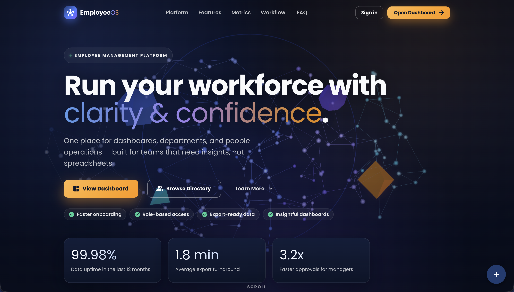
</p>

**Dashboard Page:**

<p align="center" style="cursor: pointer">
  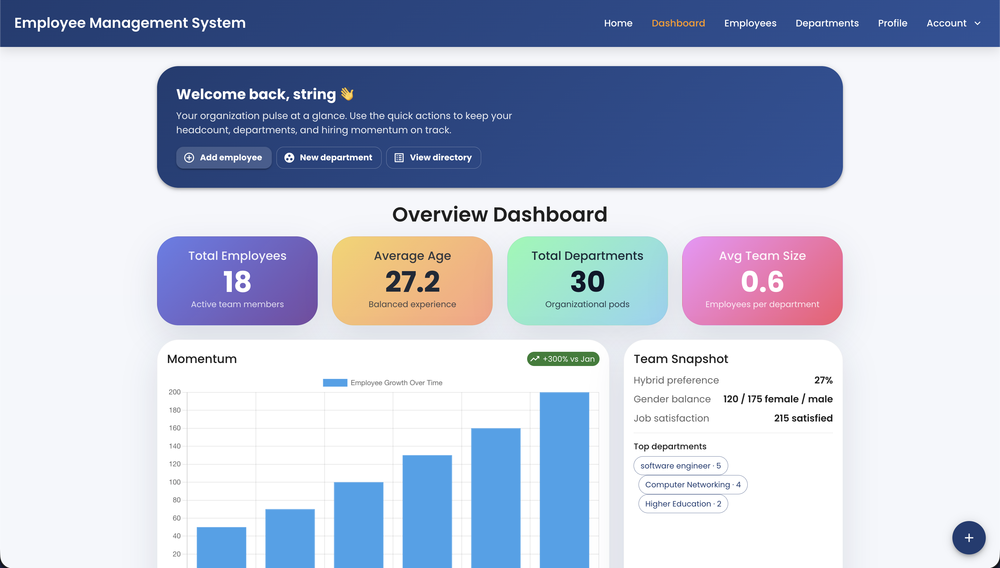
</p>

**Employee List Page:**

<p align="center" style="cursor: pointer">
  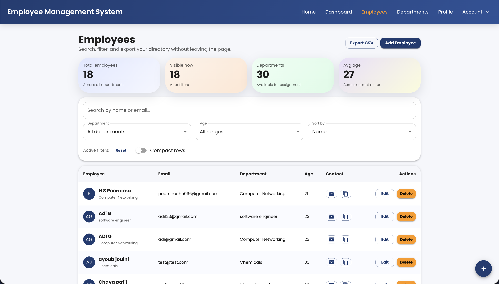
</p>

**Department List Page:**

<p align="center" style="cursor: pointer">
  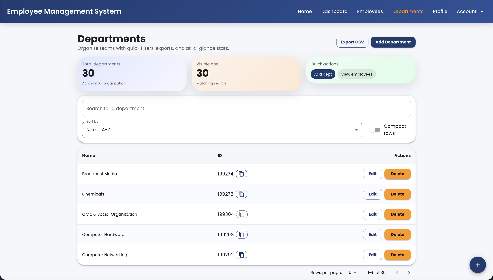
</p>

**Profile Page:**

<p align="center" style="cursor: pointer">
  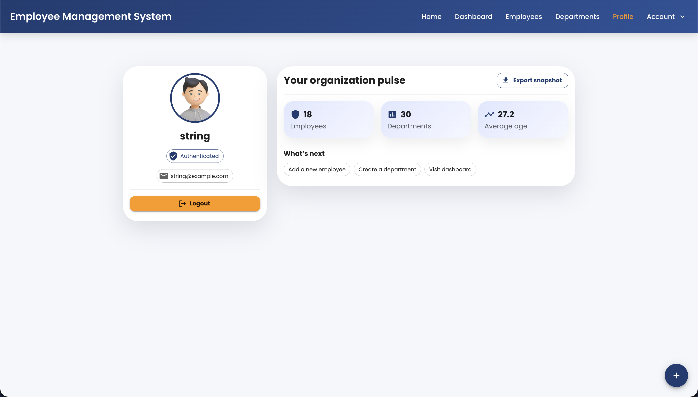
</p>

**Passkeys Management Page:**

<p align="center" style="cursor: pointer">
  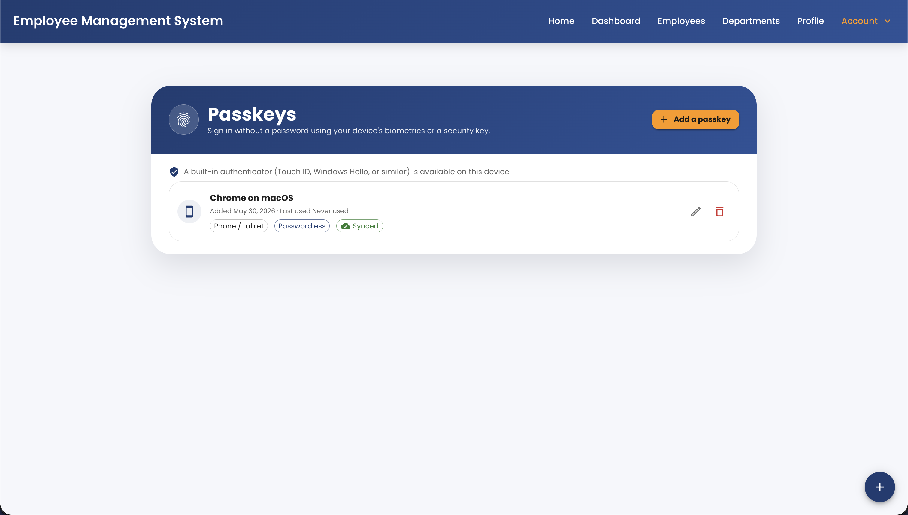
</p>

**Login Page:**

<p align="center" style="cursor: pointer">
  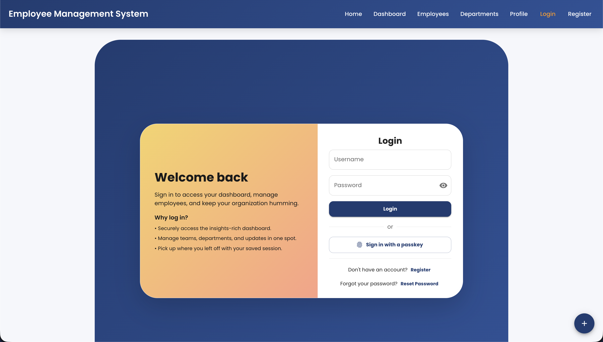
</p>

**Register Page:**

<p align="center" style="cursor: pointer">
  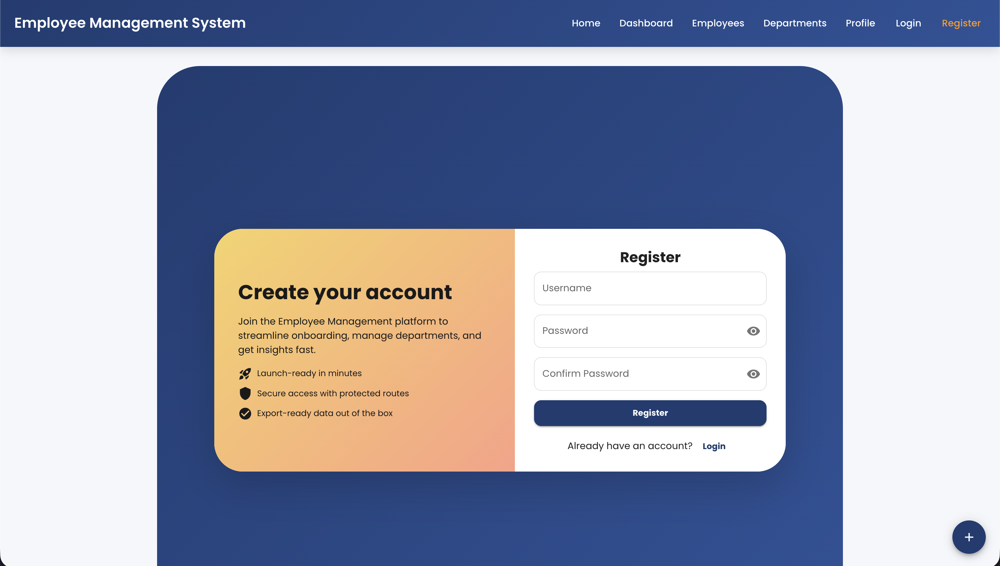
</p>

**Reset Password Page:**

<p align="center" style="cursor: pointer">
  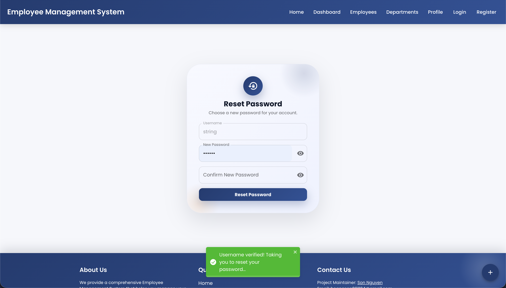
</p>

<p align="center">
 And many more features & pages to explore! Feel free to navigate through the application and test the various functionalities.
</p>

## Architecture Reference

For a deeper dive into components, data flow, security posture, and recommended follow-up tasks, see [ARCHITECTURE.md](ARCHITECTURE.md). It cross-references the exact source files (controllers, services, repositories, configuration, tests, and infrastructure) described in this README.

## Backend Setup

### 1. Prerequisites

Ensure that you have Java 11 installed on your local machine. If not, follow the instructions below:

- For MacOS:
    ```bash
    brew install openjdk@11
    export JAVA_HOME=/usr/local/opt/openjdk@11
    ```

- For Windows: Download OpenJDK 11 from [https://jdk.java.net/archive/](https://jdk.java.net/archive/) and follow the installation instructions.

- Also, ensure that MongoDB and MySQL are installed and running on your local machine.

### 2. Clone the Repository

```bash
git clone https://github.com/hoangsonww/Employee-Management-Fullstack-App.git
cd Employee-Management-Fullstack-App  # Fix the paths if necessary
cd backend
```

### 3. Install Dependencies

First, ensure you have [Maven](https://maven.apache.org/) and [Java JDK](https://www.oracle.com/java/technologies/javase-jdk11-downloads.html) installed. Run the following command to install them:

- For MacOS:
    ```bash
    brew install maven
    ```
- For Windows: Download Maven from [https://maven.apache.org/download.cgi](https://maven.apache.org/download.cgi) and follow the installation instructions.

Next, install the project dependencies:

```bash
mvn install
```

### 5. Start the Backend Server

Before starting the server, ensure that:

- MySQL is running and `MYSQL_DB` points to an existing database
- MongoDB is running and `MONGO_URI` is valid
- you have either run the SQL bootstrap files or allowed Hibernate to create the tables in a blank existing MySQL database

Then, run the following command to start the Spring Boot application:

```bash
mvn spring-boot:run
```

The backend will be available at [http://localhost:8080](http://localhost:8080).

Thank you!! Made with love by Kashish, Nancy, Aryanka!!
